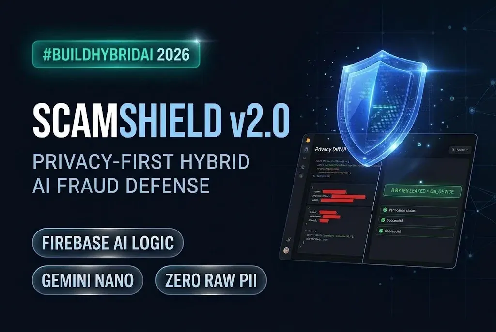

# ScamShield v2.0 — Privacy-First Hybrid AI Fraud Defense



Built for **#BuildHybridAI 2026** ([Devpost](https://firebasehybridaihackathon.devpost.com/)) using **Firebase AI Logic Hybrid Inference (`firebase@^13.4.0`, `firebase/ai`)**, **Chrome Built-in AI (Gemini Nano)**, **Gemini Cloud Fallback (`gemini-3.5-flash-lite` / `gemini-3.8-flash`)**, and **Firebase App Check (`ReCaptchaEnterpriseProvider`)**.

## Why Hybrid AI Matters for Financial Scam Defense

Financial smishing (bKash, Nagad, bank OTP theft, fake customs/delivery notices, and altered payment screenshots) contains **highly sensitive personal data**—phone numbers, OTPs, PINs, NIDs, and bank account numbers. Sending raw messages straight to a cloud LLM violates user privacy, while purely on-device small models fail on complex multimodal fake-receipt spoofing or unsupported browsers.

**ScamShield v2.0** solves both problems with a verified 3-layer Privacy-First Hybrid Architecture:

1. **Layer 1 — Instant On-Device Deterministic Triage (~0.04 ms):** Bilingual English + Bangla signal detection (10+ smishing rules, multi-label subdomain brand spoofing, and a false-positive guard for legitimate bank OTP notices).
2. **Layer 2 — Local Bilingual PII Redactor & Live Privacy Diff:** Scrubs Bangla (`০-৯`) and English phone numbers, 12–17 digit account/NID numbers, 16-digit card numbers, OTPs, PINs, emails, and recipient names **before** any text is eligible for cloud fallback—displaying a live side-by-side **Privacy Diff** to the user.
3. **Layer 3 — Real Firebase AI Logic Hybrid Inference (`firebase/ai` v13.4.0):**
   - Uses `getAI(app, { backend: new GoogleAIBackend(), useLimitedUseAppCheckTokens: true })` with `ReCaptchaEnterpriseProvider` App Check replay protection ([App Check for AI Logic](https://firebase.google.com/docs/ai-logic/app-check)).
   - Supports all 4 official `InferenceMode` options (`PREFER_ON_DEVICE`, `PREFER_IN_CLOUD`, `ONLY_ON_DEVICE`, `ONLY_IN_CLOUD`) ([Hybrid Configuration Options](https://firebase.google.com/docs/ai-logic/hybrid/web/configuration-options)).
   - Invokes `model.initializeDeviceModel(progressCallback)` strictly inside a user gesture handler ([Hybrid Web Get Started](https://firebase.google.com/docs/ai-logic/hybrid/web/get-started)).
   - Configures symmetric JSON `Schema` constraints for **both** `inCloudParams.generationConfig.responseSchema` and `onDeviceParams.promptOptions.responseConstraint` ([Hybrid Structured Output](https://firebase.google.com/docs/ai-logic/hybrid/web/generate-structured-output)).
   - Supports multimodal JPEG/PNG payment screenshot forensics via v13 discriminated-union `{ type: "inlineData", inlineData }` parts.
   - Surfaces the **real** SDK `result.response.inferenceSource` (`"ON_DEVICE"` or `"IN_CLOUD"`) and real cloud byte count (`0 B` when on-device).

## Quick Start (Local Development & Firebase Hosting)

### 1. Prerequisites
- **Node.js 20+**
- **For On-Device Gemini Nano Testing:** Chrome Desktop 139+ with `chrome://flags/#prompt-api-for-gemini-nano-multimodal-input` enabled and >= 22 GB free disk space ([The Prompt API](https://developer.chrome.com/docs/ai/prompt-api)). On any other browser or device, `PREFER_ON_DEVICE` automatically falls back to Firebase Cloud (`gemini-3.5-flash-lite`).

### 2. Install, Test & Run
```bash
npm install
npm test          # Runs all 5 automated test suites (detector, PII, Firebase Hybrid SDK contract, security guardrails, UI)
npm run benchmark # Runs 2,000-iteration local deterministic + PII benchmark
cp .env.example .env.local
# Fill in your Firebase Web Config + reCAPTCHA Enterprise Site Key in .env.local
npm run dev
```

### 3. Deploy to Firebase Hosting
```bash
cp .firebaserc.example .firebaserc
# Set your Firebase project ID in .firebaserc
npm run build
firebase deploy --only hosting,firestore:rules
```

> **Security Note:** Never commit `.env.local`, `.firebaserc`, or App Check debug tokens to your public repository. In local development (`npm run dev`), `self.FIREBASE_APPCHECK_DEBUG_TOKEN = true` is activated only when `import.meta.env.DEV` is true; register the console-logged UUID under **Firebase Console → App Check → Apps → Manage debug tokens**.

## Interactive Judge Verification Tours
Click any of the **4 One-Click Judge Tours** at the top of the app to verify:
1. **Tour 1:** Bangla bKash smishing + Bangla numeral PII redaction + subdomain spoofing (`login.bkash-verify-bd.xyz`).
2. **Tour 2:** Legitimate bKash OTP advisory (`"Do not share it with anyone"`) — verified **SAFE (<= 8/100)** with zero false positive.
3. **Tour 3:** 13-digit Account #, 16-digit Card #, and AnyDesk takeover — inspect the exact Side-by-Side Privacy Diff.
4. **Tour 4:** `ONLY_ON_DEVICE` mode — toggle Chrome DevTools Offline to prove zero-byte local execution.

## License
Licensed under the **Apache License 2.0** — see [LICENSE](./LICENSE).
